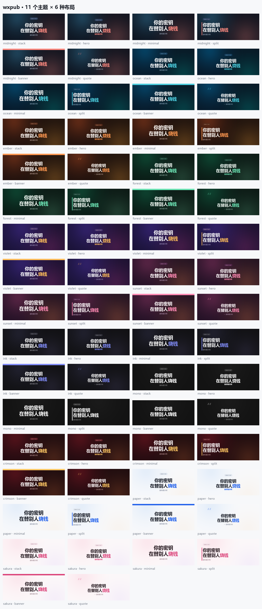
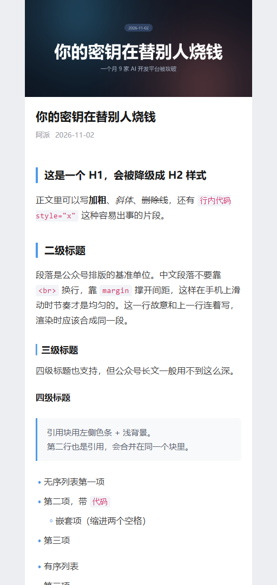

# wxpub · 微信公众号写作与草稿箱

**用 `wechat-writing` 写公众号，用 `wxpub` 预览和推草稿箱。** 你可以从 AI 新闻找选题，也可以直接交自己的主题、实操流程或初稿。写完可做模型封面、改成小红书笔记，或生成适合微信的 HTML。

| 名称 | 用在哪里 |
|---|---|
| [`wechat-writing`](skills/wechat-writing) | WorkBuddy / Claude Code 的写作 Skill。选题、找自己的案例、调研、起草、审稿、封面和小红书改写。 |
| `wxpub` | 终端命令。读取 Markdown 与封面，生成本地预览，上传图片并创建微信草稿。也可以单独使用。 |

## 快速上手

### 从 WorkBuddy 或 Claude Code 开始

在 WorkBuddy 的「添加技能 → 上传技能」导入 [`skills/wechat-writing`](skills/wechat-writing) 目录或包含该目录的 ZIP。Claude Code 用户把同一目录复制到 `~/.claude/skills/`，然后在新会话使用 `/wechat-writing` 或自然语言。

> 用 wechat-writing 写一篇公众号。主题和步骤我已整理好，按我的实测顺序写。重点讲第二步为什么失败。保留版本号、命令和我确认过的结果，先只出 Markdown。

| 你可以说 | 会拿到什么 |
|---|---|
| 「今天 AI 新闻里有什么值得写？」 | 候选主题、原始来源和推荐理由。 |
| 「在我指定的实验记录里找相关案例，顺便查官方资料」 | 带出处的真实案例。需要多轮搜索时，调研结果随查随存到 `research.md`。 |
| 「只改开头和结尾，删套话和重复」 | 按指定范围修改的稿件，沿用作者语气并保留事实与限制条件。 |
| 「用这张旧封面做参考，给这篇生成一版封面和预览」 | 模型成图、微信 HTML 和本地预览。 |
| 「把这篇改成小红书笔记」 | 单独的 `xiaohongshu.md`，按笔记阅读顺序重写。 |

只写稿和改稿时可以直接用 Skill。封面生图调用宿主已有的图像工具。范文库为可选功能，安装命令是 `uv tool install wewrite`。

### 从 Markdown 开始

需要 Python 3.9+、Pillow 和 requests。已有 Markdown 时，可直接安装命令并预览。

```bash
pip install git+https://github.com/mantuoluozk/wxpub.git
wxpub publish article.md --dry-run -o out
```

打开 `out/preview.html` 查看手机宽度排版。`out/article.html` 是内联样式的成品。预览无需公众号凭证。

```markdown
---
title: 我怎么定位这次推理掉速
subtitle: 一次从日志到可复现结论的排查
author: 你的署名
cover: cover.png
---

正文从这里开始。
```

有现成封面时，填相对路径 `cover: cover.png` 或传 `--cover`。推草稿箱前配置一次 AppID / AppSecret，再跑体检。

```bash
wxpub init         # 创建 ~/.wxpub/.env 模板，在本机填写账号凭证
wxpub doctor       # 检查字体、凭证、出口 IP 与接口权限
wxpub publish article.md -o out
```

也可以沿用 `~/.baoyu-skills/.env` 里的已有配置。最后一条命令把成稿放进公众号草稿箱，正式发文可在后台完成。

## 封面与预览

Skill 默认让图像模型直接生成整张封面。它会看文章和你提供的旧图，按 2.35:1 构图，把主体与必要文字留在中间。成图进同一个预览和推送流程。[封面规则](skills/wechat-writing/references/cover.md)

`wxpub cover` 也提供本地模板，支持 11 套主题、6 种布局。可以读 Markdown 的标题和副标题，也可以单独传标题。

```bash
wxpub cover article.md -o cover.png
wxpub cover article.md --theme ocean --layout hero
wxpub themes
```





## 微信发布细节

- 预览和交付 HTML 使用内联样式。推草稿时，工具上传正文图、处理常见图片格式，检查引用、站外链接和正文长度。
- `40164` 时先用 `wxpub doctor` 核对出口 IP 与公众号后台白名单。
- 如果账号没有草稿箱接口权限，仍可用 `--dry-run` 生成 HTML，再贴进后台编辑器。
- 具体限制、错误提示与修复办法见 [实测踩坑记录](PITFALLS.md)。

## 来源与致谢

| 项目 | 在 wxpub 里的用途 |
|---|---|
| [Humanizer-zh](https://github.com/op7418/Humanizer-zh) | 三遍审校的第二遍用它精简表达，处理复读、套话和模板句。 |
| [WeWrite](https://github.com/imraywang/wewrite) | 内置部分编辑和跨平台参考，可选使用本地范文库。 |
| [Skill-Bible · xhs-content](https://github.com/Luyu2026/Skill-Bible/tree/main/xiaohongshu-operations-skills/xhs-content) | 内置的小红书体裁参考。上游原文采用 CC BY-NC 4.0。 |
| [花叔的 huashu-skills](https://github.com/alchaincyf/huashu-skills) · [参考图生成](https://github.com/alchaincyf/huashu-gpt-image) | 借鉴选题、三遍审校、个人素材搜索、多轮调研、按范围编辑与主题封面。相关规则已写进 `wechat-writing`。 |
| [宝玉的 baoyu-skills](https://github.com/JimLiu/baoyu-skills) | 早期公众号工作流使用过的发布工具，`wxpub` 兼容原有凭证配置。 |
| [daily-ai-news](https://github.com/mantuoluozk/daily-ai-news) · [AIHot](https://aihot.news/) | 日报选题流程已合并到此仓库，AI 新闻候选来自 AIHot。 |

内置文件、版本与许可见 [上游来源](skills/wechat-writing/references/upstream/README.md)。

## 开发与测试

```bash
git clone https://github.com/mantuoluozk/wxpub.git
cd wxpub
pip install -e .
python -m unittest discover -s tests
```

项目采用 [MIT](LICENSE)，随附的第三方资料保留各自许可。

