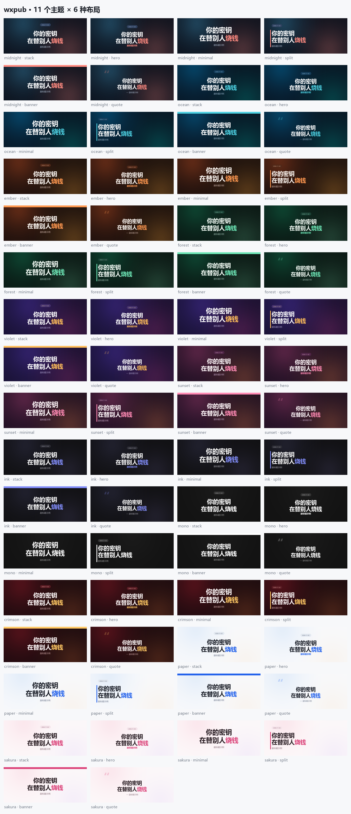
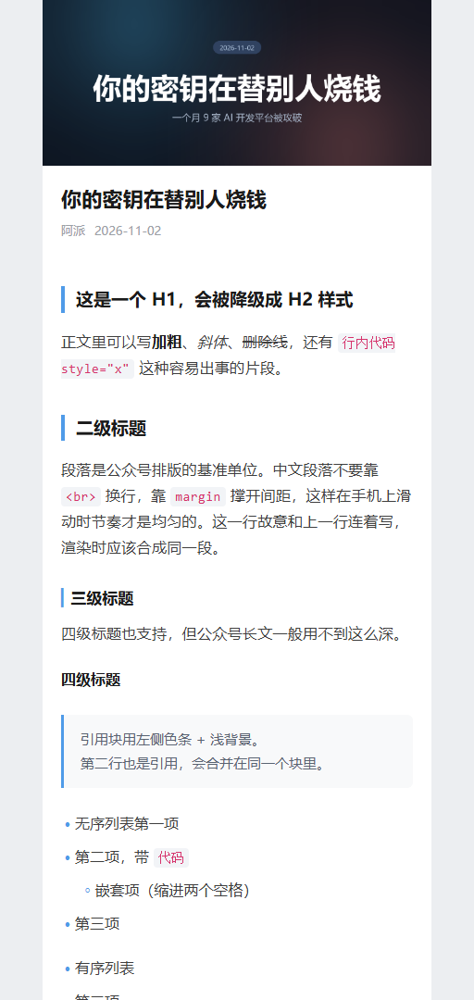

# wxpub

**Markdown 一键发进微信公众号草稿箱，顺带把封面画好。**

不用再开浏览器排版、不用手动传图、不会被 `40164` 卡半小时。

```bash
wxpub publish article.md --dry-run   # 本地看成品
wxpub publish article.md             # 推到草稿箱
```

---

## 它长什么样

封面是代码画的，不是 AI 生图 —— 中文字不会乱码，改一个字重跑 0.1 秒：



正文排版直接内联到每个标签里，粘进公众号后台就是成品，不用二次调样式。
下面这张是 `--dry-run` 生成的本地预览，就是你手机上看到的样子：



| 命令 | 产出 |
|---|---|
| `wxpub cover` | 1280×544 封面，11 主题 × 6 布局 |
| `wxpub publish --dry-run` | 本地 `preview.html`（手机宽度预览）+ 成品 HTML |
| `wxpub publish` | 封面 → 永久素材，正文图 → CDN，文章 → 草稿箱 |
| `wxpub doctor` | 凭证、字体、出口 IP、接口权限，一次全查 |

---

## 为什么又造一个轮子

因为发一篇公众号文章，真正花时间的不是写，是这 21 个坑：

> 封面用 16:9 被信息流裁掉两侧 · 中文字在生图模型里变乱码 · 网页图存下来是 WebP 微信不收 ·
> 正文图片 1MB 就上传失败 · `40164 invalid ip` 不知道要去哪加白名单 · 白名单加了还报错因为在缓存 ·
> 代理让出口 IP 变了 · access_token 被另一个脚本顶掉 · 外文引用超 50 词卡住原创声明 ·
> 标题超 64 字发布会失败 · **`45166` 这个微信错误码表里根本没有的错误** · 长代码块要横向滑才能看全 …

完整的 21 条在 [PITFALLS.md](PITFALLS.md)，每条都写清了现象、原因和这个工具怎么处理。

其中最后那几条，是写这个工具时真踩到的 —— 第一版渲染器老老实实生成了 `<a href>` 超链接，
真发布直接 `45166`。现在链接统一渲染成带虚线的 `span`，提交前还有一道全文清洗兜底。

**别人的工具帮你转换格式，这个工具帮你避坑。**

---

## 安装

需要 Python 3.9+。只有两个依赖：Pillow 和 requests。

```bash
pip install git+https://github.com/mantuoluozk/wxpub.git
```

或者本地开发：

```bash
git clone https://github.com/mantuoluozk/wxpub.git
cd wxpub
pip install -e .
```

> Linux 上如果提示找不到中文字体：`sudo apt install fonts-noto-cjk`（工具会告诉你缺什么）

---

## 30 秒上手

**1. 配凭证**（只需一次）

```bash
wxpub init            # 生成 ~/.wxpub/.env 模板
```

去 [mp.weixin.qq.com](https://mp.weixin.qq.com) → 设置与开发 → 基本配置，把 AppID 和 AppSecret 填进那个文件。

**2. 体检**

```bash
wxpub doctor
```

```
✓ Python 3.13.12
✓ Pillow 13.0.0
✓ 中文字体
    标题  C:\Windows\Fonts\msyhbd.ttc
✓ AppID     wx1234567890abcdef
✓ AppSecret 1a2b****************9f8e
✓ 当前出口 IP  203.0.113.7
✓ access_token 获取成功
✓ 草稿箱接口可用（现有草稿 3 篇）
```

**3. 写一篇文章**

```markdown
---
title: 你的密钥在替别人烧钱
subtitle: 一个月 9 家 AI 开发平台被攻破
date: 2026-11-02
author: 阿派
theme: midnight
layout: stack
---

正文写 **markdown** 就行。
```

**4. 先看效果，再发**

```bash
wxpub publish article.md --dry-run
```

打开生成的 `out/preview.html`，就是手机上看到的样子。满意了：

```bash
wxpub publish article.md
```

草稿已经在你后台了，去确认一下就能群发。

---

## 封面：不调样式，只调参数

```bash
wxpub cover --title "你的密钥|在替别人**烧钱**" --subtitle "副标题" --theme midnight
```

- `|` 分行，`**文字**` 高亮（用主题色）
- 字号按可用宽度自动收缩，实在放不下才折行，折行优先断在标点后
- 所有关键文字**强制水平居中** —— 因为信息流会裁掉封面左右两边，靠边就等于看不见
- 整块内容垂直居中，不硬编码 y 坐标

```bash
wxpub themes                          # 看所有主题和布局
wxpub cover --all-themes --title "T"  # 一次出一套，挑一张
```

| 主题 | 布局 |
|---|---|
| `midnight` 午夜蓝 · `ocean` 深海 · `ember` 余烬 | `stack` 双行大标题（默认，最稳） |
| `forest` 墨林 · `violet` 紫夜 · `sunset` 暮色 | `hero` 单行超大标题（结论式） |
| `ink` 浓墨 · `mono` 极简灰 · `crimson` 朱印 | `minimal` 只有标题（缩略图最清晰） |
| `paper` 纸白 · `sakura` 浅樱（浅色系） | `split` 左对齐竖条 · `banner` 顶部色带 · `quote` 引号水印 |

---

## 报错会告诉你怎么修

其他工具到这里就结束了：

```
errcode: 40164, errmsg: invalid ip 203.0.113.7, not in whitelist
```

wxpub 会接着说：

```
微信接口报错 40164（出错环节：上传封面）
  调用方 IP 不在公众号白名单里
  原因：微信只允许白名单内的 IP 调用接口。你的出口 IP 变了 ——
        换网络、重拨宽带、开/关代理、云主机重建，都会变。
  怎么修：
    1. 拿到本机当前出口 IP：wxpub doctor 会自动打印，或手动 curl https://api.ipify.org
    2. 打开 mp.weixin.qq.com → 设置与开发 → 基本配置 → IP 白名单 → 修改
    3. 把刚才的 IP 加进去。IPv4 和 IPv6 分两栏，都要加
    4. 保存后等 1-2 分钟再重试。微信有缓存，这期间会继续报 40164，不是没加成功
  报错里的 IP：203.0.113.7
```

已收录 17 个高频错误码。除了 `40164`，还有那个微信错误码表里查不到的 `45166`，以及最容易被误判成配置问题的 `48001`（个人未认证订阅号用不了草稿箱接口）。

---

## 发布前自动体检

`publish` 会把能预见的坑扫一遍，**不阻断发布，只提醒**：

```
! 发布前检查发现 3 条，建议先看一遍：
  · 第 2 段引用里有 47 个英文词（超过 30 词安全线）：「This is a very long...」
    建议缩成一句短引 + 中文复述 + 文末链接，否则「编辑原创」可能卡住保存
  · 正文有 1 个站外链接（如 https://example.com/...）。公众号里站外链接不可点击
  · 图片 img.png [WEBP 1200x800 340KB]：格式 WEBP → PNG（微信不收这种格式）
```

---

## 一些边界

**个人未认证订阅号用不了草稿箱接口。** 微信要求「已认证的订阅号或服务号」，返回 `48001`。
这不是配置问题，是账号资质。这种情况下用 `--dry-run` 生成成品 HTML，手动粘进后台编辑器 —— 样式已经全部内联，粘过去就是排版好的样子。

**站外链接在公众号里不可点击。** 微信的限制，不是工具的问题。建议放文末或转二维码。

**正文 HTML 上限 2 万字符。** 微信按源码长度算，不是按字数，长代码块很容易超。超了工具会提前告诉你。

---

## 测试

```bash
python -m unittest discover -s tests
```

143 个测试，不联网，不依赖凭证。覆盖：封面安全区（任何标题都不能画出画布）、
HTML 转义（防止注入把排版搞乱）、WebP 伪装成 png 的识别、各种畸形 markdown、错误诊断文案完整性。

---

## License

MIT
