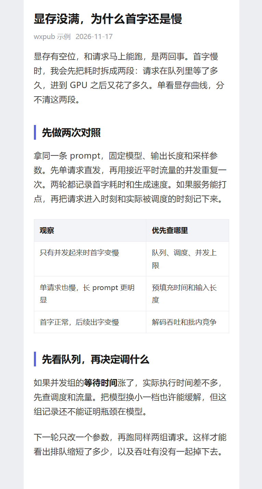

# wxpub · 微信公众号写作与草稿箱

**用 `wechat-writing` 写公众号，用 `wxpub` 预览和推草稿箱。** 你可以从 AI 新闻找选题，也可以直接交自己的主题、实操流程或初稿。写完可做模型封面、改成小红书笔记，或生成适合微信的 HTML。

| 名称 | 用在哪里 |
|---|---|
| [`wechat-writing`](skills/wechat-writing) | WorkBuddy、DSH 或 Claude Code 的写作 Skill。选题、找自己的案例、调研、起草、审稿、封面和小红书改写。 |
| `wxpub` | 终端命令。读取 Markdown 与封面，生成本地预览，上传图片并创建微信草稿。也可以单独使用。 |

## 快速上手

### WorkBuddy / DSH

在 WorkBuddy 或 DSH 安装同一份 [`wechat-writing` 技能目录](skills/wechat-writing)。先从 GitHub 下载仓库 ZIP 并解压，安装时保留整个 `wechat-writing` 目录及其 `references/`。

| 环境 | 怎么装 |
|---|---|
| WorkBuddy | 在「添加技能 → 上传技能」导入 `skills/wechat-writing` 技能包。[WorkBuddy 技能文档](https://intl.cloud.tencent.com/zh/document/product/1316/84503) |
| DSH（DeepSeek Harness） | 把 `wechat-writing` 目录复制到 `~/.dsh/skills/`；也可放到项目的 `.dsh/skills/`。[DSH 本地技能文档](https://github.com/deepseek-ai/deepseek-harness/blob/master/packages/skill/skill-filesystem/README.zh.md) |
| Claude Code | 把同一目录放到 `~/.claude/skills/`。 |

安装后用 `/wechat-writing` 或自然语言开始。


> 用 wechat-writing 写一篇公众号。主题和步骤我已整理好，按我的实测顺序写。重点讲第二步为什么失败。保留版本号、命令和我确认过的结果，先只出 Markdown。

| 你可以说 | 会拿到什么 |
|---|---|
| 「今天 AI 新闻里有什么值得写？」 | 候选主题、原始来源和推荐理由。 |
| 「在我指定的实验记录里找相关案例，顺便查官方资料」 | 带出处的真实案例。需要多轮搜索时，调研结果随查随存到 `research.md`。 |
| 「只改开头和结尾，删套话和重复」 | 按指定范围修改的稿件，沿用作者语气并保留事实与限制条件。 |
| 「用这张旧封面做参考，给这篇生成一版封面和预览」 | 模型成图、微信 HTML 和本地预览。 |
| 「把这篇改成小红书笔记」 | 单独的 `xiaohongshu.md`，按笔记阅读顺序重写。 |

只写稿和改稿时可以直接用 Skill。封面使用统一手绘风格，宿主的图像工具生成无字背景，随后叠加标题。范文库为可选功能，安装命令是 `uv tool install wewrite`。

### 从 Markdown 开始

需要 Python 3.9+、Pillow 和 requests。已有 Markdown 时，可直接安装命令并预览。

```bash
pip install git+https://github.com/mantuoluozk/wxpub.git
wxpub publish examples/demo-article.md --dry-run -o out
```

打开 `out/preview.html` 查看手机宽度排版。`out/article.html` 是内联样式的成品。预览无需公众号凭证。

可直接试跑仓库里的 [示例文章《显存没满，为什么首字还是慢》](examples/demo-article.md)。使用自己的文章时，把路径换成你的 Markdown 文件。

有现成封面时，填相对路径 `cover: cover.png` 或传 `--cover`。推草稿箱前配置一次 AppID / AppSecret，再跑体检。

```bash
wxpub init         # 创建 ~/.wxpub/.env 模板，在本机填写账号凭证
wxpub doctor       # 检查字体、凭证、出口 IP 与接口权限
wxpub publish article.md -o out
```

也可以沿用 `~/.baoyu-skills/.env` 里的已有配置。最后一条命令把成稿放进公众号草稿箱，正式发文可在后台完成。

## 成稿示例

《显存没满，为什么首字还是慢》的封面由模型绘制手绘背景，再叠加统一样式的标题。下方正文截图来自同一篇 Markdown 经 `wxpub publish --dry-run` 渲染的手机宽度预览。[查看示例 Markdown](examples/demo-article.md)





## 微信发布细节

- 预览和交付 HTML 使用内联样式。推草稿时，工具上传正文图、处理常见图片格式，检查引用、站外链接和正文长度。
- `40164` 时先用 `wxpub doctor` 核对出口 IP 与公众号后台白名单。
- 如果账号没有草稿箱接口权限，仍可用 `--dry-run` 生成 HTML，再贴进后台编辑器。
- 具体限制、错误提示与修复办法见 [实测踩坑记录](PITFALLS.md)。

## 来源与致谢

| 项目 | 在 wxpub 里的用途 |
|---|---|
| [Humanizer-zh](https://github.com/op7418/Humanizer-zh) | 三遍审校的第二遍用它精简表达，处理复读、套话和模板句。 |
| [WeWrite](https://github.com/imraywang/wewrite) | 内置部分编辑和跨平台参考，可选使用本地范文库。 |
| [Skill-Bible · xhs-content](https://github.com/Luyu2026/Skill-Bible/tree/main/xiaohongshu-operations-skills/xhs-content) | 内置的小红书体裁参考。上游原文采用 CC BY-NC 4.0。 |
| [花叔的 huashu-skills](https://github.com/alchaincyf/huashu-skills) · [参考图生成](https://github.com/alchaincyf/huashu-gpt-image) | 借鉴选题、三遍审校、个人素材搜索、多轮调研、按范围编辑与主题封面。相关规则已写进 `wechat-writing`。 |
| [宝玉的 baoyu-skills](https://github.com/JimLiu/baoyu-skills) | 早期公众号工作流使用过的发布工具，`wxpub` 兼容原有凭证配置。 |
| [daily-ai-news](https://github.com/mantuoluozk/daily-ai-news) · [AIHot](https://aihot.news/) | 日报选题流程已合并到此仓库，AI 新闻候选来自 AIHot。 |

内置文件、版本与许可见 [上游来源](skills/wechat-writing/references/upstream/README.md)。

## 开发与测试

```bash
git clone https://github.com/mantuoluozk/wxpub.git
cd wxpub
pip install -e .
python -m unittest discover -s tests
```

项目采用 [MIT](LICENSE)，随附的第三方资料保留各自许可。

