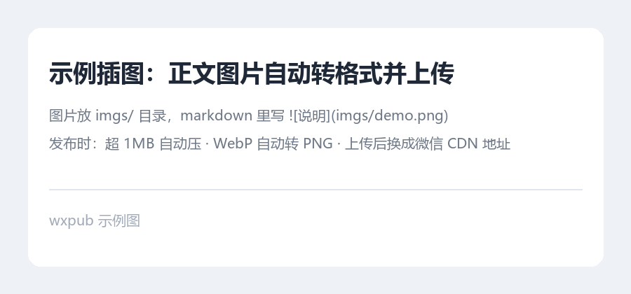

# 这是一个 H1，会被降级成 H2 样式

正文里可以写**加粗**、*斜体*、~~删除线~~，还有 `行内代码 style="x"` 这种容易出事的片段。

## 二级标题

段落是公众号排版的基准单位。中文段落不要靠 `<br>` 换行，靠 `margin` 撑开间距，
这样在手机上滑动时节奏才是均匀的。这一行故意和上一行连着写，渲染时应该合成同一段。

### 三级标题

四级标题也支持，但公众号长文一般用不到这么深。

#### 四级标题

> 引用块用左侧色条 + 浅背景。
> 第二行也是引用，会合并在同一个块里。

- 无序列表第一项
- 第二项，带 `代码`
  - 嵌套项（缩进两个空格）
- 第三项

1. 有序列表
2. 第二项

| 事件 | 结果 | 损失 |
|---|---|---|
| 平台被攻破 | 密钥泄露 | 10 万美元 |
| 扩展投毒 | 凭据外传 | 未知 |

```python
def hello(name: str) -> str:
    """注意 <script> 和 & 符号必须被转义，长行会自动折行而不是横向溢出"""
    return f"<b>{name}</b>"
```

---

一段带链接的文字，公众号站内链接是可点的：[微信开放文档](https://mp.weixin.qq.com/s/example)。



文末一句话收尾。
